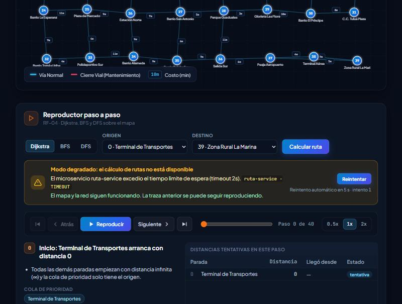

# SCRUM-32 [RQ-01-UI] · Modo degradado en pantalla

**Criterio de aceptación:** si `ruta-service` cae, la pantalla no se queda en blanco ni con un spinner infinito. El mapa sigue visible y navegable, y aparece un aviso con botón "Reintentar".

**Resultado:** ✅ medido en el navegador con el sistema completo en Docker, con la sesión de `consultor` y la red de 40 paradas.

| Momento | Qué se hizo | Qué se vio | Tiempo |
|---|---|---|---:|
| Línea base | Calcular ruta 0 → 39 | Traza de 40 pasos | — |
| Falla | `docker stop ruta-service` y luego Calcular ruta | Aviso "Modo degradado" con motivo `ruta-service · TIMEOUT`, botón Reintentar y cuenta regresiva; el mapa sigue con sus 40 paradas y la traza anterior se puede seguir reproduciendo | **2,05 s** desde el clic |
| Recuperación | `docker start ruta-service` sin tocar la página | El reintento automático vuelve a calcular la ruta y aparece "El cálculo de rutas volvió a responder" | **10,2 s** desde `docker start` |

La meta de W-RQ-01 es recuperarse en menos de 30 s sin refrescar. El contenedor tardó 11,0 s en quedar `healthy`; la pantalla volvió antes porque el reintento llegó en cuanto el servicio aceptó peticiones.



## Cómo funciona

- **Cuándo se activa.** Si el gateway responde 503 (lo hace a los 2 s, por SCRUM-17), si no hay conexión con el gateway (status 0) o si responde 502 o 504. Un 400, 401 o 403 no es una caída: se muestra como error normal.
- **Spinner infinito, imposible.** El navegador también corta a los 6 s (`MS_LIMITE_CONSULTA`). Así, aunque el propio gateway quede colgado, la pantalla sale del estado "Calculando…".
- **Reintento.** Se puede reintentar a mano con el botón, o esperar al reintento automático cada 10 s (`SEGUNDOS_REINTENTO`). El aviso muestra la cuenta regresiva y el número de intento.
- **Al volver el servicio.** El aviso desaparece y queda un mensaje verde que dice cuánto duró la caída. La traza nueva se carga sola.
- **Lo que sigue funcionando.** El mapa lo dibuja el visor con datos de `grafo-service`, que no depende de `ruta-service` (D-01). Además, la última traza calculada sigue en memoria y se puede reproducir paso a paso.

Código en `frontend/red-rutas-web/src/app/reproductor/` (`reproductor.service.ts` y `reproductor.component.html`).

## Pruebas automáticas (Vitest)

| Prueba | Qué comprueba |
|---|---|
| 503 activa el modo degradado | No se pierde la traza anterior ni el paso en que iba |
| Reintento cada 10 s | Cuenta intentos fallidos y sale del modo degradado cuando el servicio responde |
| Sin conexión con el gateway | También es modo degradado (`api-gateway · SIN_CONEXION`) |
| Nadie responde | A los 6 s se corta la petición y se apaga el spinner |
| 400 | Es un error normal, no una caída |
| Componente | Muestra el aviso y el botón; al reintentar con éxito desaparece el aviso y carga la traza |

```bash
cd frontend/red-rutas-web && npx ng test --watch=false   # 67 pruebas, 0 fallos
```

## Cómo repetirlo

1. Levantar el sistema:

   ```bash
   docker compose up -d
   ```

2. Entrar con `consultor` y calcular una ruta.
3. Apagar el servicio y volver a calcular; debe aparecer el aviso:

   ```bash
   docker stop ruta-service
   ```

4. Prender el servicio sin recargar la página; antes de 30 s debe aparecer el mensaje verde:

   ```bash
   docker start ruta-service
   ```
