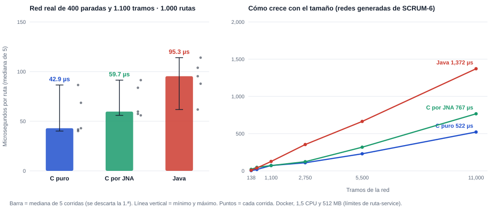

# SCRUM-37 [RN-BENCH] · Banco C vs. Java con 1.000 rutas

**Criterio de aceptación:** comparar el tiempo de cálculo de C y Java con 1.000 rutas, reportar la mediana de 5 corridas y una gráfica comparativa de costo y tiempo.

**Resultado:** ✅ en la red real de 400 paradas y 1.100 tramos (la `redId 2` de `grafo-service`), con 1.000 rutas:

| Motor | Mediana por ruta | Respecto a C puro |
|---|---:|---:|
| **C puro** (`dijkstra()` desde un programa en C) | **42,9 µs** | 1,0× |
| **C por JNA** (`libgrafo.so` llamada desde Java, como en producción) | **59,7 µs** | 1,4× |
| **Java** (`DijkstraJava`, el respaldo de `ruta-service`) | **95,3 µs** | 2,2× |

- **Paridad:** en las 7 redes medidas, C y Java dan el mismo costo **y el mismo camino** en las 1.000 rutas (1.000/1.000), gracias a la regla de desempate D-06. Si un solo costo no coincidiera, el banco se detendría.
- Las tres cifras están muy por debajo de los 400 ms de RQ-03: una ruta tarda menos de 0,1 ms en cualquiera de los tres.



## Cómo crece con el tamaño de la red

Son las mismas redes generadas de SCRUM-6 (mismas semillas), con 1.000 rutas cada una. Mediana en µs por ruta:

| Paradas | Tramos | C puro | C por JNA | Java | Java / C puro | JNA / C puro |
|---:|---:|---:|---:|---:|---:|---:|
| 50 | 138 | 3,0 | 19,7 | 8,5 | 2,9× | 6,7× |
| 150 | 413 | 18,6 | 47,5 | 38,4 | 2,1× | 2,6× |
| 400 | 1.100 | 71,8 | 71,4 | 126,1 | 1,8× | 1,0× |
| 1.000 | 2.750 | 109,0 | 122,9 | 354,1 | 3,2× | 1,1× |
| 2.000 | 5.500 | 229,7 | 317,8 | 664,2 | 2,9× | 1,4× |
| 4.000 | 11.000 | 521,8 | 766,7 | 1.372,1 | 2,6× | 1,5× |

Datos crudos: [`scrum37_banco.csv`](scrum37_banco.csv) (las 6 corridas de cada motor, marcando la descartada) · resumen: [`scrum37_resumen.csv`](scrum37_resumen.csv) · consola: [`scrum37_salida.txt`](scrum37_salida.txt).

## Qué se concluye

1. **El algoritmo en C es entre 2 y 3 veces más rápido que en Java** en todas las redes y en las dos corridas que se hicieron. Es la ventaja que justifica tener Dijkstra en C (A-RQ-01).
2. **Cruzar de Java a C por JNA tiene un costo fijo por llamada.** En cada consulta JNA copia a memoria nativa los tres arreglos de la red (3 × 1.100 enteros con 400 paradas) y devuelve el camino (D-02).
   - En redes pequeñas ese costo domina: con 50 paradas, C por JNA (19,7 µs) es **más lento que Java** (8,5 µs).
   - Desde unas 400 paradas el cálculo pesa más que la copia, y C por JNA queda por delante de Java.
3. **Con el tamaño del proyecto (400 paradas), la ganancia real en producción es menor que la del algoritmo solo:** 1,6× entre C por JNA y Java, contra 2,2× entre C puro y Java. En la repetición, C por JNA y Java quedaron casi iguales (72,6 y 70,5 µs), así que a este tamaño la diferencia está cerca del ruido de la medición.
4. **Mejora posible (no implementada):** cargar la red una sola vez en memoria nativa y pasar solo origen y destino en cada consulta quitaría casi toda la copia. Cambia la firma congelada de `grafo.h` (D-08), así que queda como recomendación para la bitácora.

## Ruido de la medición

Se midió en un portátil con Windows, dentro de la máquina virtual de Docker Desktop. Las 5 corridas de un mismo motor llegan a variar hasta 2× entre sí; la gráfica muestra ese rango con la línea de mínimo y máximo. Para comprobar qué se sostiene, se repitió todo fijando el contenedor a dos núcleos (`--cpuset-cpus=2,3`, sin cuota): [`scrum37_banco_repeticion.csv`](scrum37_banco_repeticion.csv), [`scrum37_salida_repeticion.txt`](scrum37_salida_repeticion.txt).

| En la repetición | Red real 400 | Rango Java / C puro en todas las redes |
|---|---|---|
| C puro / C por JNA / Java | 41,5 / 72,6 / 70,5 µs | 1,7× a 3,5× |

Las conclusiones 1 y 2 se mantienen en las dos corridas. Las cifras exactas de la tabla no deben leerse con más de un dígito de precisión.

## Cómo se midió

- **Mismas entradas para los tres motores.** El banco Java genera la red y las 1.000 consultas con semilla fija, mide Java y C por JNA en el mismo proceso, y escribe la misma red a un archivo que lee `banco_c` (C puro).
- **Calentamiento y corridas.** Antes de medir se corren 2.000 consultas para que el JIT de Java compile. Luego cada motor hace 6 corridas de 1.000 rutas; se descarta la primera y se toma la mediana de las otras 5. El orden Java/JNA se alterna en cada corrida.
- **Igual que en producción.** C por JNA reserva la salida en Java igual que `SelectorAlgoritmo`. Java usa `DijkstraJava.calcular`, que en esta versión también registra la traza del reproductor (SCRUM-31), como en producción.
- **Entorno.** Contenedor Alpine con el mismo `gcc -O2` de la imagen de producción y Java 21, con los límites de `ruta-service` en `docker-compose.yml`: 1,5 CPU y 512 MB.

```bash
cd backend
docker build -f ruta-service/Dockerfile.banco -t villanos-banco .
docker run --rm --cpus=1.5 --memory=512m -v "$(pwd)/../docs/mediciones:/salida" villanos-banco
python ruta-service/native/graficar_banco.py ../docs/mediciones/scrum37_banco.csv ../docs/mediciones/scrum37_banco.svg
```

Código:

- `backend/ruta-service/src/test/java/com/villanos/ruta/banco/BancoCvsJava.java`: el banco. No es una prueba JUnit, así que `mvn test` no lo ejecuta.
- `backend/ruta-service/native/banco_c.c`: C puro. Se compila con `make banco_c`.
- `backend/ruta-service/native/graficar_banco.py`: la gráfica.
- `backend/ruta-service/Dockerfile.banco`: el entorno de medición.
