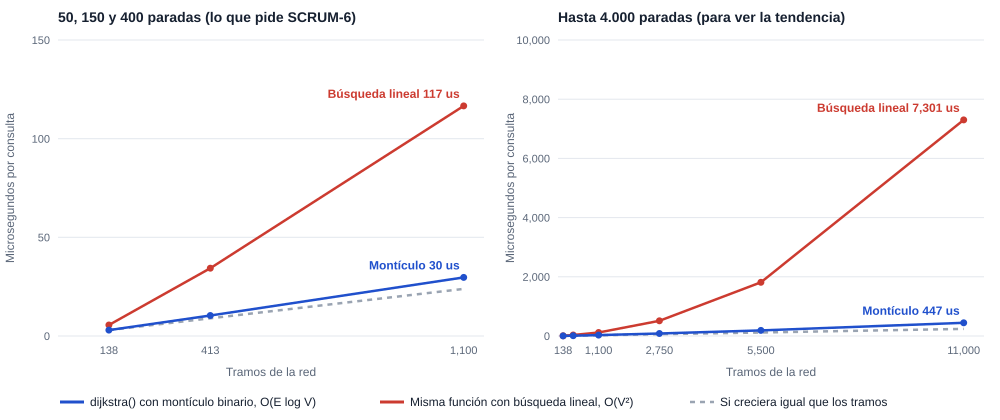

# SCRUM-6 [RN-02] · Montículo binario en `dijkstra()`

**Criterio de aceptación:** el tiempo sobre grafos de 50, 150 y 400 paradas crece de forma cercana a lineal en el número de tramos. Si crece como el cuadrado del número de paradas, la cola de prioridad no está funcionando.

**Resultado:** ✅ se cumple. De 50 a 400 paradas los tramos crecen ×8 y el tiempo con montículo crece ×9,9, que es lo esperado para O(E log V) (×12). La misma función con búsqueda lineal crece ×21 y, con redes más grandes, se dispara hacia V².



## Datos (mediana por consulta)

| Paradas | Tramos | Con montículo (µs) | Búsqueda lineal (µs) | Lineal / montículo |
|---:|---:|---:|---:|---:|
| 50 | 138 | 2,99 | 5,56 | 1,9× |
| 150 | 413 | 10,39 | 34,34 | 3,3× |
| **400** | **1.100** | **29,68** | **116,59** | **3,9×** |
| 1.000 | 2.750 | 83,07 | 513,94 | 6,2× |
| 2.000 | 5.500 | 187,81 | 1.814,09 | 9,7× |
| 4.000 | 11.000 | 447,18 | 7.301,49 | 16,3× |

Datos crudos: [`scrum6_monticulo.csv`](scrum6_monticulo.csv) · salida de consola: [`scrum6_salida.txt`](scrum6_salida.txt).

## Cómo leerlo

| De 50 a… | Tramos (E) | E·log V | V² | Montículo | Lineal |
|---|---:|---:|---:|---:|---:|
| 400 paradas | ×8 | ×12,3 | ×64 | **×9,9** | ×21 |
| 4.000 paradas | ×80 | ×169 | ×6.400 | **×149** | ×1.314 |

- La versión con montículo sigue a E·log V: crece un poco más que los tramos (por el log V) y muy lejos de V².
- La búsqueda lineal no llega a ×64 ni a ×6.400 porque Dijkstra se detiene al cerrar el destino (en promedio recorre media red) y porque una parte del tiempo es armar la lista de adyacencia, que es igual en las dos. Aun así, su curva se dobla hacia arriba: en 4.000 paradas ya es 16 veces más lenta.
- Con las 400 paradas del proyecto, una ruta tarda unos **30 µs** en C, muy por debajo de los 400 ms que pide RQ-03.

## Cómo se midió (para repetirlo)

```bash
cd backend/ruta-service/native
make medicion                                   # 50, 150 y 400 paradas
./bench --grande --csv ../../../docs/mediciones/scrum6_monticulo.csv
python graficar_medicion.py ../../../docs/mediciones/scrum6_monticulo.csv ../../../docs/mediciones/scrum6_monticulo.svg
```

- **Redes:** generadas con semilla fija (siempre las mismas), conexas, con 2,75 tramos por parada. Así 400 paradas dan 1.100 tramos, el tamaño del documento de Arquitectura. Pesos de 1 a 15 minutos.
- **Consultas:** 1.000 parejas origen-destino al azar (semilla fija). Son las mismas para las dos versiones.
- **Corridas:** 6 por versión; se descarta la primera (calentamiento de caché) y se reporta la mediana de las otras 5.
- **Contraste:** `dijkstra_lineal()` en `bench.c` es la misma función, cambiando solo la forma de escoger la siguiente parada (recorre todas, O(V)). Las dos dan los mismos costos en las 1.000 consultas; si no, el banco se detiene con error.
- **Equipo:** laptop de desarrollo, Windows 11, gcc 15.1 (MSYS2) con `-O2`, 11 nov 2026. Los valores absolutos cambian de máquina a máquina; lo que importa es cómo crecen.
