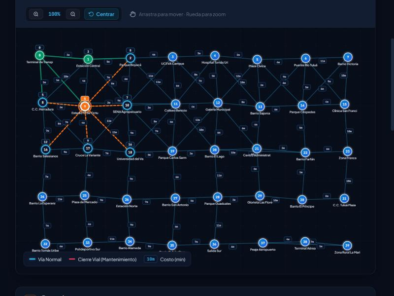
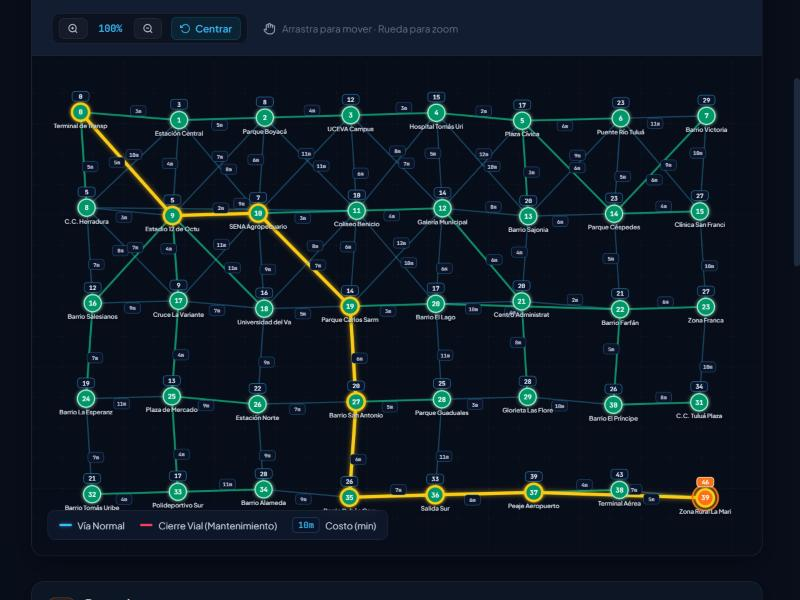

# SCRUM-31 [RF-04] · Reproductor paso a paso (VCR)

**Criterio de aceptación:** en cada paso se ilumina el nodo actual, los ya cerrados en verde, y una tabla muestra la distancia tentativa de cada parada. Retroceder un paso deja el estado exactamente como estaba, sin reiniciar.

**Resultado:** ✅ verificado en el navegador con el sistema completo en Docker (Keycloak, grafo-service, ruta-service en modo `native` y api-gateway), con sesión de `consultor`, sobre la red de 40 paradas.

| Comprobación | Resultado |
|---|---|
| Ruta Terminal de Transportes (0) → Zona Rural La Marina (39) | 40 pasos; el último cierra la parada 39 con distancia **46**, igual al costo que calcula C |
| Retroceder del paso 4 al 3 | Título, las 9 filas de la tabla y el color de las paradas en el mapa quedan **idénticos** a los que había |
| Reproducir a 2x desde el paso 3 | 37 pasos en 19,0 s (medio segundo por paso) y se detiene solo en el último |
| Último paso | Ruta de 46 min dibujada en amarillo: 9 paradas y 8 tramos |
| BFS y DFS desde la parada 0 | Mismo reproductor; BFS visita 0 → 1 → 8 → 9 y DFS 0 → 1 → 2 → 3 (igual que en SCRUM-23) |



*Paso 3. Naranja: la parada actual y los tramos que revisa. Verde: las paradas cerradas y el árbol de caminos. Encima de cada parada aparece su distancia tentativa.*



*Último paso. En amarillo, la ruta de 46 min que calculó `libgrafo.so`.*

## Cómo se usa

En la pantalla principal, debajo del mapa:

1. Se elige el algoritmo: **Dijkstra**, **BFS** o **DFS** (RF-05 usa el mismo reproductor).
2. Se elige el origen y, para Dijkstra, el destino. Luego se pulsa **Calcular ruta** o **Recorrer red**.
3. Los controles disponibles son:
   - **Ir al inicio**, **Atrás**, **Reproducir/Pausa**, **Siguiente** e **Ir al final**;
   - una línea de tiempo para saltar a cualquier paso;
   - la velocidad: **0.5x**, **1x** o **2x**. A 1x avanza un paso por segundo.
4. Atajos de teclado: <kbd>←</kbd> <kbd>→</kbd> para retroceder o avanzar, y <kbd>espacio</kbd> para reproducir o pausar.

En cada paso se ve:

- el texto de qué pasó: qué parada salió de la cola y qué le pasó a cada vecino, por ejemplo "SENA Agropecuario: 11 → 7 (5 + 2). Mejora.";
- la cola de prioridad, la cola o la pila;
- la tabla de distancias tentativas (o del nivel y la profundidad, en BFS y DFS), con el valor anterior tachado cuando mejora.

## Backend: traza en `/api/rutas/calcular`

`GET /api/rutas/calcular?desde=0&hasta=39&traza=true` (por el gateway, cualquier rol). Sin `traza=true` la respuesta queda igual que antes.

```json
{
  "costoTotal": 46, "camino": [0, 9, 10, 19, 27, 35, 36, 37, 39], "modoEfectivo": "NATIVE",
  "trazaCalculadaCon": "JAVA",
  "pasos": [
    { "paso": 1, "actual": 0, "distancia": 0, "desde": -1,
      "relajaciones": [
        { "vecino": 1, "peso": 3, "anterior": null, "propuesta": 3, "mejora": true },
        { "vecino": 8, "peso": 5, "anterior": null, "propuesta": 5, "mejora": true }, ...
      ] },
    ...
  ]
}
```

- Cada paso dice:
  - qué parada se cierra, con qué distancia y desde cuál se llegó;
  - para cada vecino abierto: la distancia que tenía (`null` = infinito), la que tendría pasando por aquí y si mejoró.
- El camino y el costo los sigue calculando C. La traza la arma `DijkstraJava` sobre la misma red. Ver [D-17](../Bitacora_Decisiones.md#d-17).

## Frontend

Archivos en `frontend/red-rutas-web/src/app/reproductor/`:

| Archivo | Qué hace |
|---|---|
| `traza.model.ts` | Tipos de la traza y de las respuestas del backend |
| `traza.builder.ts` | Convierte la respuesta de Dijkstra, BFS o DFS en una **foto completa del estado por paso** |
| `reproductor.service.ts` | Estado compartido con Signals: paso actual, reproducción, velocidad. El visor del grafo lo lee para pintar |
| `reproductor.component.*` | Consulta, controles VCR, explicación del paso y tabla |

Retroceder no deshace nada: cada paso ya tiene su foto y el reproductor solo cambia el índice. Por eso volver un paso muestra exactamente lo mismo que antes. Ver [D-18](../Bitacora_Decisiones.md#d-18).

En el visor de Jhonatan (`grafo-visor`) solo se agregaron clases de color y la etiqueta con el valor tentativo; el paneo, el zoom y el inspector no cambian.

## Pruebas automáticas

| Suite | Pruebas nuevas | Qué comprueban |
|---|---|---|
| `TrazaDijkstraTest` (JUnit) | 4 | La traza del grafo guía de 5 paradas (A–E) coincide paso a paso con la traza hecha a mano; también el caso de misma parada y el de destino inalcanzable |
| `RutaControllerTest` (JUnit) | 3 | Sin `traza` no se agregan pasos; con `traza=true` el último paso es el destino y su distancia es el costo; respeta `sin=` |
| `traza.builder.spec.ts` (Vitest) | 9 | Fotos por paso independientes (los pasos siguientes no alteran los anteriores), estados y valores; BFS y DFS |
| `reproductor.service.spec.ts` (Vitest) | 11 | Retroceder restaura el mismo estado, límites, play/pausa, velocidades 0.5x/1x/2x con temporizador simulado, ruta solo al final, mensajes 401 y 503 |
| `reproductor.component.spec.ts` (Vitest) | 6 | Tabla y contador al avanzar y retroceder, resultado final, validación de origen = destino, atajos de teclado |

```bash
# ruta-service: 76 pruebas, 0 fallos
cd backend/ruta-service && mvn test

# frontend: 62 pruebas, 0 fallos
cd frontend/red-rutas-web && npx ng test --watch=false
```
