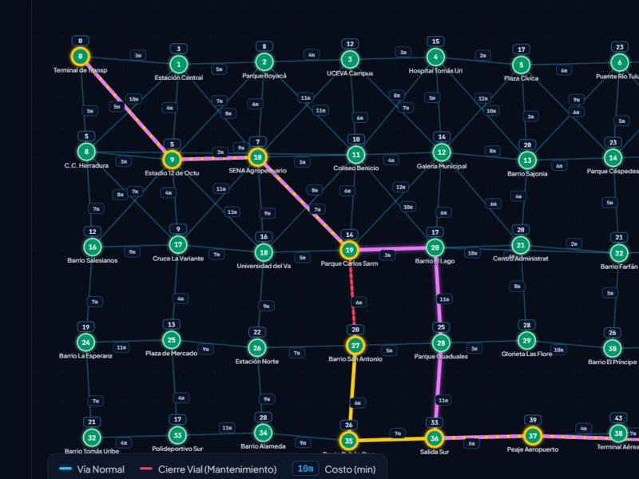

# SCRUM-33 [RF-08] · Comparador de 2 rutas

**Criterio de aceptación:** se guarda la ruta calculada y se superpone con la ruta que resulta tras cerrar un tramo, en dos colores distintos. Se muestra la diferencia de caminos y el cambio de costo (por ejemplo, "Aumentó en +9 minutos").

**Resultado:** ✅ verificado en el navegador con el sistema en Docker. La ruta original es Terminal de Transportes (0) → Zona Rural La Marina (39), de **46 min**. Se cerró, uno por uno, cada tramo de esa ruta:

| Tramo cerrado | Ruta con el cierre | Cambio |
|---|---|---|
| 64 · Terminal ↔ Estadio 12 de Octubre | 48 min, entra por Estación Central | Aumentó en +2 minutos |
| 5 · Estadio 12 de Octubre ↔ SENA Agropecuario | 50 min, va directo de Estación Central a SENA | Aumentó en +4 minutos |
| 81 · SENA Agropecuario ↔ Parque Carlos Sarmiento | 48 min, pasa por Coliseo Benicio | Aumentó en +2 minutos |
| **41 · Parque Carlos Sarmiento ↔ Barrio San Antonio** | **52 min, por Barrio El Lago y Parque Guaduales** | **Aumentó en +6 minutos** |
| 55 · Barrio San Antonio ↔ Barrio Rubén Cruz | 49 min, por Parque Guaduales | Aumentó en +3 minutos |
| 63 · Barrio Rubén Cruz ↔ Salida Sur | 49 min, por Parque Guaduales | Aumentó en +3 minutos |
| 90 · Salida Sur ↔ Peaje Aeropuerto | **sin camino** | La parada 39 queda inalcanzable |
| 89 · Peaje Aeropuerto ↔ Zona Rural La Marina | 48 min, por Terminal Aérea | Aumentó en +2 minutos |

El tramo 90 es un puente de la red: es el mismo que en SCRUM-24 deja 3 paradas aisladas.



*Tramo 41 cerrado. Amarillo: solo ruta original. Fucsia: solo ruta con el cierre. Rayas amarillo y fucsia: tramos que comparten. Rojo punteado: el tramo cerrado.*

## Cómo se usa

1. En el reproductor se calcula una ruta con Dijkstra.
2. Debajo aparece **Comparar con un tramo cerrado**. La lista muestra primero los tramos de la ruta, que son los que cambian algo al cerrarse, y después el resto.
3. **Comparar** pide a `ruta-service` la misma ruta con `sin=<id del tramo>`. No modifica la red guardada: es una simulación. El mapa se pone en el último paso del reproductor y superpone las dos rutas.
4. El panel muestra:
   - el cambio de costo;
   - las dos rutas con su costo;
   - qué paradas deja de usar y cuáles agrega la ruta nueva.
5. **Quitar comparación** vuelve al reproductor normal. Calcular otra ruta también borra la comparación anterior.

Código: `frontend/red-rutas-web/src/app/reproductor/comparador/`. En el visor del grafo solo se agregaron las clases de color de la comparación.

## Pruebas automáticas (Vitest)

| Prueba | Qué comprueba |
|---|---|
| Texto del cambio | Aumentó, disminuyó, sin cambio, sin camino; singular y plural |
| Comparar rutas | Delta y paradas que se dejan o se agregan, sobre el grafo guía. Al cerrar B–D: A→B→D→E (11) pasa a A→C→D→E (12), +1 |
| Petición | Usa `sin=<id>` y clasifica cada tramo: original, alterna, compartido, cerrado o ninguno |
| Servicio caído | Informa que no se pudo comparar |
| Componente | Solo aparece con una ruta de Dijkstra; ofrece primero los tramos de la ruta; muestra delta y rutas; una ruta nueva borra la comparación |

```bash
cd frontend/red-rutas-web && npx ng test --watch=false   # 84 pruebas, 0 fallos
```
