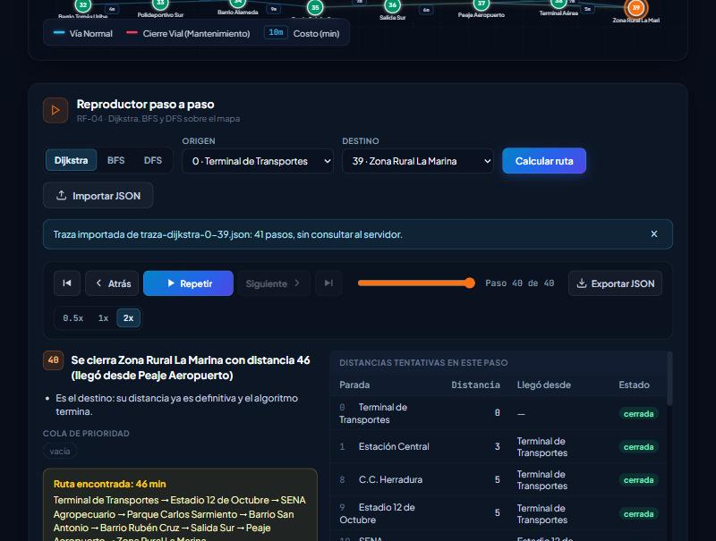

# SCRUM-34 [RF-09] · Exportar e importar la traza en JSON

**Criterio de aceptación:** se descarga la traza completa y, al importarla, se reproduce paso a paso sin consultar al backend.

**Resultado:** ✅ verificado en el navegador con el sistema en Docker.

| Paso | Resultado |
|---|---|
| 1. Calcular la ruta 0 → 39 y pulsar **Exportar JSON** | Archivo `traza-dijkstra-0-39-20261117-1738.json`: 41 pasos, 398 KB |
| 2. `docker stop ruta-service` y recargar la página | El cálculo de rutas queda caído |
| 3. **Importar JSON** con ese archivo y reproducir a 2x hasta el final | 41 pasos, ruta de 46 min con sus 8 tramos dibujados. **0 peticiones** al gateway durante la importación y la reproducción |



## Formato del archivo

```json
{
  "formato": "villanos-red-de-rutas/traza",
  "version": 1,
  "exportado": "2026-11-17T17:38:04.512Z",
  "red": { "redId": 1, "nombre": "Red Urbana de Transporte (40 Paradas)", "paradas": 40 },
  "traza": {
    "algoritmo": "dijkstra", "desde": 0, "hasta": 39, "costoTotal": 46,
    "camino": [0, 9, 10, 19, 27, 35, 36, 37, 39], "modoEfectivo": "NATIVE",
    "pasos": [ { "numero": 0, "titulo": "...", "estados": {}, "filas": [], "arbol": [], "evaluadas": [] }, ... ]
  }
}
```

- `traza` es exactamente lo que usa el reproductor: las fotos completas de cada paso (D-18). Por eso, al importarla, no hay que recalcular nada ni llamar al servidor.
- Sirve igual para Dijkstra, BFS y DFS. El nombre del archivo dice el algoritmo, el origen, el destino y la fecha.
- `red` registra de qué red salió la traza, para auditar la corrida.

## Validaciones al importar

El archivo se rechaza con un mensaje si:

- no es JSON;
- no tiene el campo `formato` de Red de Rutas;
- es de otra versión;
- le falta el algoritmo, el inicio o la red;
- no tiene pasos, o alguno está incompleto;
- usa una parada que la red cargada no tiene. Si la traza viene de otra red pero cabe en la actual, se carga y se avisa.

Código: `frontend/red-rutas-web/src/app/reproductor/traza-archivo.ts` y los botones en `reproductor.component.html`.

## Pruebas automáticas (Vitest)

| Prueba | Qué comprueba |
|---|---|
| Ida y vuelta | Exportar y volver a leer da la misma traza, también para BFS |
| Nombre del archivo | Incluye algoritmo, origen, destino y fecha |
| Archivos inválidos | Los 6 casos de rechazo dan su mensaje |
| Importar en el componente | Se reproduce hasta el final sin ninguna petición HTTP (`expectNone`) |
| Red más pequeña | No importa una traza con paradas que la red no tiene |
| Exportar | Genera la descarga y avisa cuántos pasos tiene |

```bash
cd frontend/red-rutas-web && npx ng test --watch=false   # 75 pruebas, 0 fallos
```
